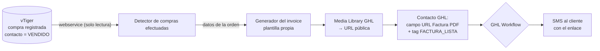

# 🧾 LOA Invoice Engine

**Motor independiente de facturas en PDF.** Detecta las **compras efectuadas** en vTiger CRM (contacto en estado `VENDIDO`), **genera el PDF del invoice**, lo publica en la **Media Library de la Cuenta Empresa de GoHighLevel** y deja el contacto marcado para que un **workflow de GHL** lo envíe por **SMS** al cliente que cerró su compra.

> Este repositorio es **autónomo**: no importa nada de LOA Engine, no usa librerías de terceros (cero dependencias) y se ejecuta por sí solo.

---

## 🧭 Cómo funciona



**Contrato publicado en GHL** (el workflow se arma contra esto):

| Elemento | Nombre | Rol |
|---|---|---|
| Campo personalizado | `URL Factura PDF` | URL pública del PDF |
| Campo personalizado | `Factura Nº Orden` | **Idempotencia**: número ya publicado |
| Tag | `FACTURA_LISTA` | **Dispara** el workflow |
| Tag | `FACTURA_ENVIADA` | Cierre: impide reenvíos |

---

## 🛡️ Garantías de diseño

1. **vTiger es solo lectura, en 3 capas**: solo GET (POST únicamente para el login), allow-list de operaciones (`query`, `getchallenge`, `login`) y allow-list de acciones web (`Login`, `ExportPDF`, `Detail`, `index`). `Save/Edit/Delete/MassEdit/Import` se rechazan **antes** de tocar la red.
2. **Idempotencia en dos niveles**: cursor local (`data/cursor.json`) + campo `Factura Nº Orden` en el contacto (fuente de verdad final). El cliente **nunca** recibe dos veces la misma factura.
3. **Corte temprano**: si la orden ya fue publicada, no se descarga ni se sube nada (ahorra cuota y evita trabajo inútil).
4. **Fail-safe total**: ninguna función lanza hacia afuera; todo devuelve `{ ok, motivo, detalle }`. Una caída de vTiger o GHL no tumba el ciclo.
5. **Nada se publica a ciegas**: si el contacto no se puede leer, si no hay campos puente resueltos o si no hay URL, el flujo se detiene.
6. **El interruptor nace apagado** (`INVOICE_PDF_ENABLED=false`).
7. **Discreción**: el motor no envía mensajes ni expone nombres de tratamientos; el copy vive en el workflow.

---

## 🚀 Puesta en marcha

```bash
# 1. Configuración
cp .env.example .env      # completar credenciales (ver abajo)
node src/cli.js check     # valida config y accesos SIN publicar nada

# 2. Muestra del invoice con datos reales (no publica nada)
node src/cli.js preview --record=6x35385

# 3. Prueba controlada de UNA factura
node src/cli.js publish --contact=CONTACT_ID_GHL --order=6x35385

# 4. Operación
node src/cli.js serve     # DISPARADOR POR EVENTO (recomendado, sin barrido)
node src/cli.js once      # recuperación manual: un barrido
node src/cli.js scan      # recuperación continua
```

### Variables de entorno

| Variable | Para qué |
|---|---|
| `INVOICE_PDF_ENABLED` | Interruptor general (nace `false`) |
| `VTIGER_URL`, `VTIGER_USERNAME`, `VTIGER_ACCESS_KEY` | Webservice: leer compras (solo lectura) |
| `VTIGER_WEB_USERNAME`, `VTIGER_WEB_PASSWORD` | **Sesión web**: descargar el PDF oficial |
| `GHL_API_KEY_CENTRAL`, `GHL_LOCATION_ID_CENTRAL` | Cuenta Empresa: subir el PDF y marcar el contacto |
| `INVOICE_SCAN_SEDE`, `INVOICE_SCAN_DIAS`, `INVOICE_SCAN_BATCH`, `INVOICE_SCAN_INTERVAL_MINUTES` | Detección de compras |

**Scopes necesarios en el PIT de la Cuenta Empresa:** `medias.read`, `medias.write`, `contacts.readonly`, `contacts.write`, `locations.readonly`, `customFields.readonly`.

> Si `check` reporta `TOKEN_INVALIDO` (401) el PIT está revocado; si reporta `SCOPE_FALTANTE` (403), falta habilitar `medias.write`.

---

## ⚡ Disparador: un evento por venta (recomendado — sin barrido)

El motor **no recorre la base**: espera que le avisen. **Un evento = una venta = una factura**, en segundos.

```bash
npm run serve        # levanta el endpoint de eventos (INVOICE_TRIGGER=evento)
```

| Ruta | Uso |
|---|---|
| `GET /salud` | Verificación de vida (para el CRM o el monitor) |
| `POST /evento/compra` | Evento de venta efectuada (requiere el header `x-loa-token`) |

**Vía A — Webhook de vTiger** (si tu instancia tiene la acción *Webhook* en Workflow):
1. CRM Settings → Automation → **Workflow** → nuevo.
2. Condición: `Contacts` → *Estado de Venta* (`cf_994`) **es** `VENDIDO`.
3. Acción **Webhook** → `POST https://<tu-motor>/evento/compra`, con header `x-loa-token: <token>` y body JSON:
   ```json
   { "salesorder_id": "<id de la orden>", "contact_id": "<id del contacto>" }
   ```

**Vía B — Enganche al sync existente** (sin tocar vTiger): el motor LOA que ya sincroniza por `last_modified_time` llama a `atenderEventoCompra(payload)` cuando detecta el cambio a `VENDIDO`. Mismo código, sin HTTP.

**Prueba en 10 segundos:**
```bash
curl -X POST http://127.0.0.1:3100/evento/compra \
  -H "content-type: application/json" \
  -H "x-loa-token: $INVOICE_WEBHOOK_TOKEN" \
  -d '{"salesorder_id":"6x35385"}'
```

**Respuestas pensadas para el CRM:** `200` publicada **o** ya publicada (idempotente, no reintentar) · `422` faltan datos (orden/contacto aún no disponibles) · `503` fallo temporal de GHL → **reintentar** · `401` token inválido · `404` ruta desconocida.

> El barrido (`once` / `scan`) queda como **modo recuperación** para casos puntuales (por ejemplo, si el motor estuvo caído). El flujo normal es el evento.
>
> ⚠️ El endpoint debe estar **siempre disponible** (Render/Railway como servicio web, no como cron). Si el motor está caído cuando llega el evento, ese evento se pierde: para eso está el modo recuperación.

---

## 🤖 Workflow en GHL (Cuenta Empresa) — envío por SMS

**Disparador del flujo completo:** el personal registra la compra en vTiger y el contacto queda con estado **`VENDIDO`** (`cf_994`). El motor lo detecta en el siguiente ciclo (2-5 min), genera el invoice, lo publica y marca el contacto con el tag `FACTURA_LISTA`. **No hay que cambiar nada en el trabajo del personal**: ellos siguen usando vTiger como siempre.

Armado del workflow (5 minutos):

1. **Campos personalizados** (Settings → Custom Fields → Contact): crear `URL Factura PDF` y `Factura Nº Orden` (texto). Los nombres deben ser **exactos**: el motor los resuelve por nombre.
2. **Workflow nuevo** → Trigger: *Contact Tag* → **Tag Added** → `FACTURA_LISTA`.
3. **Filtro**: `URL Factura PDF` *is not empty*.
4. **Acción** — *Send SMS*:
   > {{contact.first_name}}, tu compra quedó registrada. Aquí puedes ver y descargar tu factura:
   > {{contact.url_factura_pdf}}
   > Cualquier duda, respóndenos por aquí. — Laboratorios Naturales
5. **Acción secundaria**: añadir tag `FACTURA_ENVIADA` y quitar `FACTURA_LISTA`.
6. **Ventana de envío**: L-V 07:00-22:00 / S-D 10:00-16:00.
7. **Reintento**: si el envío falla, esperar 1 h y reintentar una sola vez.

> ✅ **Por qué SMS es el camino simple:** el SMS solo lleva un **enlace** (no un archivo adjunto), así que no depende de plantillas aprobadas por Meta ni de ventanas de 24 h: sale siempre, a la hora que sea. El PDF vive en la Media Library de GHL y el enlace es la URL pública.
>
> ⚠️ **Discreción**: el mensaje no debe nombrar el tratamiento ni el producto (artritis, próstata, etc.). Solo factura + enlace.

---

## 🧪 Pruebas

```bash
npm test                    # 12 suites (430 asserts)
npm run test:evento         # disparador por evento + servidor de webhooks
npm run test:render         # generador del invoice (modelo + PDF)
npm run test:bridge         # contrato + idempotencia
npm run test:websession     # sesión web vTiger (CSRF, cookies, ExportPDF)
npm run test:media          # subida a la Media Library y modos de fallo
npm run test:delivery       # caso de uso completo
npm run test:publisher      # integración vTiger + GHL (red simulada)
npm run test:detector       # detección de compras + cursor
npm run test:index          # API pública (todos los exports y candados)
npm run test:cli            # CLI real, en seco (sin credenciales)
npm run test:e2e            # integración por HTTP real: servidores vTiger y GHL en localhost
```

> **`test:e2e`** levanta dos servidores HTTP locales que hablan el protocolo real (login web con cookies y 302, `ExportPDF`, subida multipart, contactos y tags) y ejecuta el flujo completo **y el CLI** contra ellos. Verifica lo que un doble de `fetch` no puede: el multipart que viaja por la red, las cookies de sesión y las cabeceras de autenticación.

### Qué está verificado y qué no

| Verificado con dobles de prueba (cero red) | Verificado contra el sistema real |
|---|---|
| Toda la lógica de idempotencia y el contrato de campos/tags | ✅ Formulario de login de vTiger (v7, CSRF `__vtrftk`, **sin captcha**) |
| Sesión web: CSRF, cookies, caché, *single-flight*, renovación | ✅ `ORDER BY spl_fecha_ultima_compra DESC` y filtro por fecha en vTiger |
| Subida multipart y **todos** los modos de fallo (401/403/5xx/red) | ✅ Contactos y `SalesOrder` legibles (campo `total` **denegado**: se usa `hdnGrandTotal`) |
| Flujo completo `vTiger → PDF → GHL → tags` | ✅ Invoice generado con **datos reales** (`S-96567` · ELIZABETH CRUZ · `PO BOX 229` · 210,00 USD) |
| Detección de compras, cursor y reintentos | ✅ Disparador real: `cf_994 = "VENDIDO"`, nº `S-XXXXX` de `salesorder_no`, dirección en la **orden** (denegada en el contacto) |
| Publicación en la Media Library | ✅ **Subida real HTTP 201** → URL pública `https://assets.cdn.filesafe.space/.../media/….pdf` |
| — | ⏳ Prueba de punta a punta marcando un contacto real y enviando el SMS (requiere campos + workflow en GHL) |

---

## 📦 Despliegue en Render (24/7)

El motor es un **servicio WEB** (no cron): el endpoint de eventos debe estar siempre escuchando para recibir el aviso de cada venta.

| Ajuste en Render | Valor |
|---|---|
| Tipo | **Web Service** |
| Runtime / Node | **Node 20** (`NODE_VERSION=20`) |
| Build Command | `npm install` |
| Start Command | `npm run serve` |
| Health Check Path | `/salud` |
| Plan | **starter o superior** (en el plan gratuito el servicio duerme y los eventos se pierden) |
| Región | la más cercana a Miami (p. ej. `oregon`/`ohio`) |

**Variables de entorno a cargar** (los secretos, en el panel — nunca en el repo):

```
INVOICE_PDF_ENABLED=false          ← encender SOLO tras la prueba validada
VTIGER_URL=https://ventascallcenter.com
VTIGER_USERNAME=…
VTIGER_ACCESS_KEY=…
VTIGER_WEB_USERNAME=…              ← OBLIGATORIA: es la que descarga el PDF OFICIAL
VTIGER_WEB_PASSWORD=…              ← OBLIGATORIA (login web de vTiger)
INVOICE_PDF_SOURCE=vtiger          ← PDF oficial de vTiger (recomendado)
VTIGER_WEB_APP=MARKETING           ← parametro exigido por ExportPDF (sin el, devuelve HTML)
GHL_API_KEY_CENTRAL=…              ← el PIT de la Cuenta Empresa
GHL_LOCATION_ID_CENTRAL=…
GHL_BASE_URL=https://services.leadconnectorhq.com
INVOICE_TRIGGER=evento
INVOICE_WEBHOOK_TOKEN=…            ← token compartido del endpoint (48 caracteres)
INVOICE_SCAN_SEDE=PALACIOS
INVOICE_ESTADO_COMPRA=VENDIDO
INVOICE_CURSOR_PATH=/var/data/cursor.json    ← con disco persistente
INVOICE_LOG_DIR=/var/data/logs
```

> ⚠️ **Con `INVOICE_PDF_SOURCE=vtiger` (por defecto) las credenciales web son obligatorias**: el PDF es el que genera el botón "Exportar a PDF" de vTiger, y para eso hace falta usuario y contraseña web (el `access key` de la API no sirve). Si querés que el motor genere el PDF por su cuenta, poné `INVOICE_PDF_SOURCE=propio` y las web dejan de ser necesarias.

> `PORT` lo inyecta Render automáticamente y el motor lo respeta (verificado: con `PORT=10000` escucha en 10000; en local cae a `INVOICE_WEBHOOK_PORT`, 3100).
>
> Existe un `render.yaml` en la raíz como plantilla de Infrastructure as Code (el servicio se puede crear desde ahí o a mano en el panel).

**Al terminar el deploy, verificar:** `https://<tu-servicio>.onrender.com/salud` → debe responder `{"ok":true,"servicio":"loa-invoice-engine"}`.

- **Modo recuperación** (si el motor estuvo caído): `npm run once` como **Cron Job** cada N minutos, o manualmente.
- **Estado**: el cursor vive en `INVOICE_CURSOR_PATH` (por defecto `data/cursor.json`). En plataformas efímeras, montar un disco persistente; si se pierde, el campo `Factura Nº Orden` de GHL sigue evitando duplicados.
- **Auditoría**: `INVOICE_LOG_DIR/audit.jsonl` (JSONL append-only).

---

## 🗂️ Estructura

```
src/
├── config.js                     Configuración y validación (sin dependencias)
├── cli.js                        check | preview | test-pdf | publish | once | scan
├── index.js                      API pública
├── core/
│   ├── invoice_bridge.js         Contrato + idempotencia (funciones puras)
│   ├── invoice_delivery.js       Caso de uso (genera → publica → marca)
│   ├── invoice_render.js         Plantilla del invoice (modelo + PDF con pdfkit)
│   ├── invoice_publisher.js      Cableado real + resolución de campos por nombre
│   └── audit.js                  Auditoría JSONL
├── connectors/
│   ├── vtiger_webservice.js      Webservice (challenge/login/query) con candado
│   ├── vtiger_web_session.js     Sesión web + ExportPDF (Vía A, no usada hoy)
│   ├── ghl_media.js              Media Library (subida + URL pública)
│   └── ghl_client.js             HTTP con timeout y reintentos (429/red)
└── jobs/
    └── detectar_compras_nuevas.js  Detección (cf_994 = VENDIDO) + cursor + ciclo
docs/
└── FLUJOGRAMAS_PROCESOS.md       Flujograma completo: actores, fronteras y micro-procesos
tests/                            11 suites, 390 asserts
```

---

## 📄 Licencia

Uso privado — Laboratorios Naturales.
