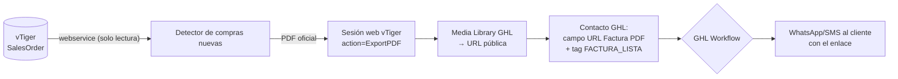

# 🧾 LOA Invoice Engine

**Motor independiente de facturas en PDF.** Detecta las **compras nuevas** en vTiger CRM, descarga el **PDF oficial de la factura**, lo publica en la **Media Library de la Cuenta Empresa de GoHighLevel** y deja el contacto marcado para que un **workflow de GHL** lo envíe por **WhatsApp/SMS** al cliente que cerró su compra.

> Este repositorio es **autónomo**: no importa nada de LOA Engine, no usa librerías de terceros (cero dependencias) y se ejecuta por sí solo.

---

## 🧭 Cómo funciona



**Contrato publicado en GHL** (el workflow se arma contra esto):

| Elemento | Nombre | Rol |
|---|---|---|
| Campo personalizado | `URL Factura PDF` | URL pública del PDF |
| Campo personalizado | `Factura Nº Orden` | **Idempotencia**: número ya publicado |
| Tag | `FACTURA_LISTA` | **Dispara** el workflow |
| Tag | `FACTURA_ENVIADA` | Cierre: impide reenvíos |

---

## 🛡️ Garantías de diseño

1. **vTiger es solo lectura, en 3 capas**: solo GET (POST únicamente para el login), allow-list de operaciones (`query`, `getchallenge`, `login`) y allow-list de acciones web (`Login`, `ExportPDF`, `Detail`, `index`). `Save/Edit/Delete/MassEdit/Import` se rechazan **antes** de tocar la red.
2. **Idempotencia en dos niveles**: cursor local (`data/cursor.json`) + campo `Factura Nº Orden` en el contacto (fuente de verdad final). El cliente **nunca** recibe dos veces la misma factura.
3. **Corte temprano**: si la orden ya fue publicada, no se descarga ni se sube nada (ahorra cuota y evita trabajo inútil).
4. **Fail-safe total**: ninguna función lanza hacia afuera; todo devuelve `{ ok, motivo, detalle }`. Una caída de vTiger o GHL no tumba el ciclo.
5. **Nada se publica a ciegas**: si el contacto no se puede leer, si no hay campos puente resueltos o si no hay URL, el flujo se detiene.
6. **El interruptor nace apagado** (`INVOICE_PDF_ENABLED=false`).
7. **Discreción**: el motor no envía mensajes ni expone nombres de tratamientos; el copy vive en el workflow.

---

## 🚀 Puesta en marcha

```bash
# 1. Configuración
cp .env.example .env      # completar credenciales (ver abajo)
node src/cli.js check     # valida config y accesos SIN publicar nada

# 2. Diagnóstico del PDF (no publica)
node src/cli.js test-pdf --record=6x35385

# 3. Prueba controlada de UNA factura
node src/cli.js publish --contact=CONTACT_ID_GHL --order=6x35385

# 4. Operación
node src/cli.js once      # un ciclo
node src/cli.js scan      # ciclo continuo cada N minutos
```

### Variables de entorno

| Variable | Para qué |
|---|---|
| `INVOICE_PDF_ENABLED` | Interruptor general (nace `false`) |
| `VTIGER_URL`, `VTIGER_USERNAME`, `VTIGER_ACCESS_KEY` | Webservice: leer compras (solo lectura) |
| `VTIGER_WEB_USERNAME`, `VTIGER_WEB_PASSWORD` | **Sesión web**: descargar el PDF oficial |
| `GHL_API_KEY_CENTRAL`, `GHL_LOCATION_ID_CENTRAL` | Cuenta Empresa: subir el PDF y marcar el contacto |
| `INVOICE_SCAN_SEDE`, `INVOICE_SCAN_DIAS`, `INVOICE_SCAN_BATCH`, `INVOICE_SCAN_INTERVAL_MINUTES` | Detección de compras |

**Scopes necesarios en el PIT de la Cuenta Empresa:** `medias.read`, `medias.write`, `contacts.readonly`, `contacts.write`, `locations.readonly`, `customFields.readonly`.

> Si `check` reporta `TOKEN_INVALIDO` (401) el PIT está revocado; si reporta `SCOPE_FALTANTE` (403), falta habilitar `medias.write`.

---

## 🤖 Workflow en GHL (Cuenta Empresa)

1. **Campos personalizados** (Settings → Custom Fields → Contact): crear `URL Factura PDF` y `Factura Nº Orden` (texto). Los nombres deben ser **exactos**: el motor los resuelve por nombre.
2. **Workflow nuevo** → Trigger: *Contact Tag* → **Tag Added** → `FACTURA_LISTA`.
3. **Filtro**: `URL Factura PDF` *is not empty*.
4. **Acción** — *Send SMS* (o WhatsApp con plantilla aprobada):
   > Hola {{contact.first_name}}, tu compra quedó registrada. Aquí puedes ver y descargar tu factura:
   > {{contact.url_factura_pdf}}
   > Cualquier duda, respóndenos por aquí. — Laboratorios Naturales
5. **Acción secundaria**: añadir tag `FACTURA_ENVIADA` y quitar `FACTURA_LISTA`.
6. **Ventana horaria**: L-V 07:00-22:00 / S-D 10:00-16:00.
7. **Reintento**: si el envío falla, esperar 1 h y reintentar una sola vez.

> ⚠️ **WhatsApp y Meta**: fuera de la ventana de 24 h desde el último mensaje del cliente, WhatsApp exige **plantilla aprobada** (con variable para la URL). El **SMS no tiene esa restricción**: si la prioridad es que salga siempre, el SMS es el canal determinista.
>
> ⚠️ **Discreción**: el mensaje no debe nombrar el tratamiento ni el producto (artritis, próstata, etc.). Solo factura + enlace.

---

## 🧪 Pruebas

```bash
npm test                    # 10 suites (338 asserts)
npm run test:bridge         # contrato + idempotencia
npm run test:websession     # sesión web vTiger (CSRF, cookies, ExportPDF)
npm run test:media          # subida a la Media Library y modos de fallo
npm run test:delivery       # caso de uso completo
npm run test:publisher      # integración vTiger + GHL (red simulada)
npm run test:detector       # detección de compras + cursor
npm run test:index          # API pública (todos los exports y candados)
npm run test:cli            # CLI real, en seco (sin credenciales)
npm run test:e2e            # integración por HTTP real: servidores vTiger y GHL en localhost
```

> **`test:e2e`** levanta dos servidores HTTP locales que hablan el protocolo real (login web con cookies y 302, `ExportPDF`, subida multipart, contactos y tags) y ejecuta el flujo completo **y el CLI** contra ellos. Verifica lo que un doble de `fetch` no puede: el multipart que viaja por la red, las cookies de sesión y las cabeceras de autenticación.

### Qué está verificado y qué no

| Verificado con dobles de prueba (cero red) | Verificado contra el sistema real |
|---|---|
| Toda la lógica de idempotencia y el contrato de campos/tags | ✅ Formulario de login de vTiger (v7, CSRF `__vtrftk`, **sin captcha**) |
| Sesión web: CSRF, cookies, caché, *single-flight*, renovación | ✅ `ORDER BY spl_fecha_ultima_compra DESC` y filtro por fecha en vTiger |
| Subida multipart y **todos** los modos de fallo (401/403/5xx/red) | ✅ Contactos y `SalesOrder` legibles (campo `total` **denegado**: se usa `hdnGrandTotal`) |
| Flujo completo `vTiger → PDF → GHL → tags` | ⏳ Descarga real del PDF oficial (requiere credenciales web) |
| Detección de compras, cursor y reintentos | ⏳ Publicación real en la Media Library (requiere PIT válido) |

---

## 📦 Despliegue

- **Cron / Render / Railway**: `npm run once` con un cron cada N minutos, o `npm start` (`scan`) como worker continuo.
- **Estado**: el cursor vive en `data/cursor.json` (incluido en `.gitignore`). En plataformas efímeras, montar un disco persistente para no perderlo (si se pierde, el campo `Factura Nº Orden` de GHL sigue evitando duplicados).
- **Auditoría**: `data/logs/audit.jsonl` (JSONL append-only).

---

## 🗂️ Estructura

```
src/
├── config.js                     Configuración y validación (sin dependencias)
├── cli.js                        check | test-pdf | publish | once | scan
├── index.js                      API pública
├── core/
│   ├── invoice_bridge.js         Contrato + idempotencia (funciones puras)
│   ├── invoice_delivery.js       Caso de uso (descarga → publica → marca)
│   ├── invoice_publisher.js      Cableado real + resolución de campos por nombre
│   └── audit.js                  Auditoría JSONL
├── connectors/
│   ├── vtiger_webservice.js      Webservice (challenge/login/query) con candado
│   ├── vtiger_web_session.js     Sesión web + ExportPDF (PDF oficial)
│   ├── ghl_media.js              Media Library (subida + URL pública)
│   └── ghl_client.js             HTTP con timeout y reintentos (429/red)
└── jobs/
    └── detectar_compras_nuevas.js  Detección + cursor + ciclo
tests/                            10 suites, 338 asserts
```

---

## 📄 Licencia

Uso privado — Laboratorios Naturales.
