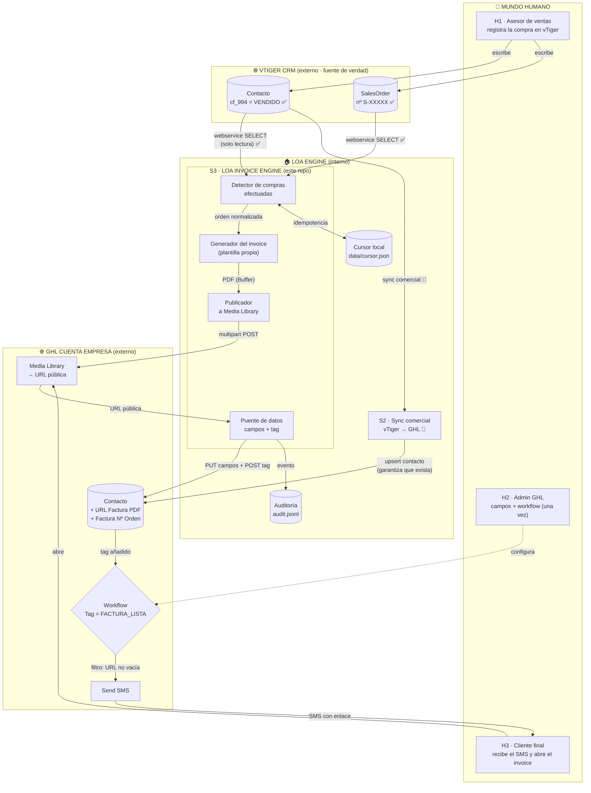
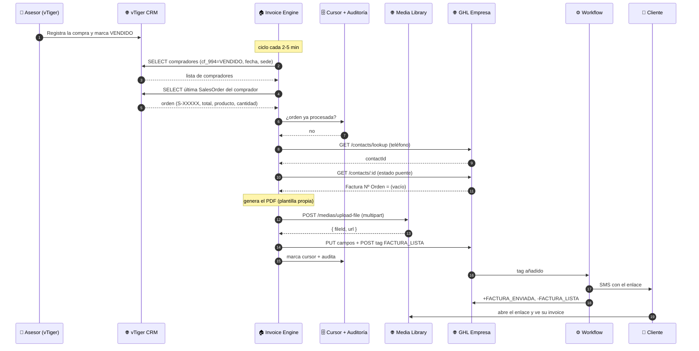
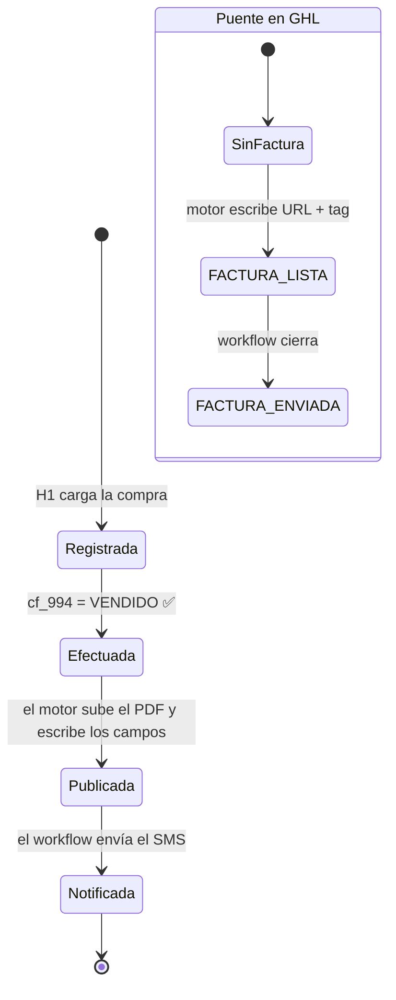

# 🗺️ Flujograma de Procesos: vTiger ↔ LOA Engine ↔ GHL ↔ Humano

**Objetivo:** entender el flujo completo del **invoice por SMS**, con cada proceso y micro-proceso, sus fronteras (interno / externo / humano), credenciales, estados, idempotencia y puntos de fallo.

**Leyenda de evidencia:**
- ✅ **Verificado en vivo** en esta sesión (contra vTiger real o GHL real).
- 📘 **Del código/configuración** del repo (no re-verificado en vivo en esta sesión).

---

## 1. Actores y sistemas

| ID | Actor / Sistema | Tipo | Rol en el flujo | Datos que toca |
|---|---|---|---|---|
| **H1** | Personal de ventas (asesor) | 👤 Humano | Registra la compra en vTiger y marca el contacto como **VENDIDO** | Orden de venta, estado del contacto |
| **H2** | Administrador de GHL | 👤 Humano | Crea los campos puente y arma el workflow (una sola vez) | Campos personalizados, workflow |
| **H3** | Cliente final | 👤 Humano | Recibe el SMS y abre el enlace del invoice | SMS, PDF |
| **S1** | vTiger CRM | 🌐 Externo (fuente de verdad comercial) | Guarda contactos, órdenes y estados | Todo el dato comercial |
| **S2** | LOA Engine (motor Node + watcher Python) | 🏠 Interno (existente) | Sincroniza vTiger → GHL (contactos, historial de órdenes, campos) | Contactos, órdenes, campos GHL |
| **S3** | LOA Invoice Engine | 🏠 **Interno (nuevo, este repo)** | Detecta la compra efectuada, genera el PDF, lo publica y marca el contacto | Orden, PDF, campos + tag en GHL |
| **S4** | GHL Cuenta Empresa | 🌐 Externo | Contactos, campos, Media Library, workflow y envío | Contacto, archivo, tag, SMS |
| **S5** | Media Library (dentro de GHL) | 🌐 Externo | Almacena el PDF y entrega la URL pública | PDF |
| **S6** | Pasarela SMS (dentro de GHL) | 🌐 Externo | Entrega el mensaje al teléfono del cliente | SMS |

---

## 2. Flujo macro (procesos y fronteras)



---

## 3. Fronteras: qué cruza, cómo y con qué credencial

| # | Frontera | Sentido | Mecanismo | Credencial | Frecuencia |
|---|---|---|---|---|---|
| **F1** | Humano → vTiger | Entrada | Interfaz web de vTiger | Usuario del asesor | Cuando cierra la venta |
| **F2** | vTiger → Invoice Engine | Lectura | Webservice: `getchallenge` + `login` + `query` (solo `SELECT`) ✅ | `VTIGER_USERNAME` + `VTIGER_ACCESS_KEY` | Cada ciclo (2-5 min) |
| **F3** | vTiger → GHL (contactos) | Lectura + escritura | Sync comercial del motor LOA 📘 | PIT de sede + Empresa | 📘 según scheduler |
| **F4** | Invoice Engine → GHL (contacto) | Lectura + escritura | API v2: `GET /contacts/:id`, `PUT /contacts/:id`, `POST /contacts/:id/tags` | `GHL_API_KEY_CENTRAL` (PIT) | 1 vez por factura |
| **F5** | Invoice Engine → Media Library | Escritura | `POST /medias/upload-file` (multipart) | PIT con `medias.write` | 1 vez por factura |
| **F6** | GHL → Cliente | Salida | Workflow → `Send SMS` | Nativo de GHL | Al recibir el tag |
| **F7** | Cliente → Media Library | Lectura | Clic en el enlace del SMS | URL pública | Cuando el cliente abre |

> 🔒 **Regla de oro respetada en todas las fronteras:** vTiger es **solo lectura** (solo GET + allow-list `query`/`getchallenge`/`login`; sentencias solo `SELECT`). El motor **nunca** escribe en el CRM.

---

## 4. Micro-procesos (detalle para operación)

### 4.1 Cadena principal del invoice

| # | Micro-proceso | Quién | Sistema | Entrada | Acción concreta | Salida | Idempotencia | Si falla |
|---|---|---|---|---|---|---|---|---|
| **M1** | Registro de la venta | H1 | vTiger | Datos del pedido | Crea/actualiza `SalesOrder` y pone el contacto en **`VENDIDO`** | Contacto `cf_994 = VENDIDO` + orden `S-XXXXX` ✅ | — | Nada se dispara (correcto) |
| **M2** | Barrido de compradores | S3 | vTiger (F2) | Sede + ventana de días | `SELECT … FROM Contacts WHERE cf_3451=<sede> AND spl_num_compras>0 AND spl_fecha_ultima_compra >= <hoy-7d> AND cf_994='VENDIDO' ORDER BY spl_fecha_ultima_compra DESC LIMIT N` ✅ | Lista de compradores | Repetible sin efectos | Se audita y se reintenta el próximo ciclo |
| **M3** | Última orden del comprador | S3 | vTiger (F2) | `contact_id` | `SELECT id, salesorder_no, createdtime, hdnGrandTotal, sostatus, cf_1069, cf_3156, cf_3298 FROM SalesOrder WHERE contact_id=… ORDER BY createdtime DESC LIMIT 1` (con `;` final) ✅ | Orden cruda | Repetible | Se registra el error y se omite ese contacto |
| **M4** | Normalización | S3 | Interno | Orden cruda | Mapea a `{ numeroOrden, fecha, total, producto, cantidad }` | Orden interna | — | — |
| **M5** | Corte por cursor | S3 | Interno + `cursor.json` | Clave `record\|numeroOrden` | Si ya está procesada → **omite** | Omisión con motivo `YA_PROCESADA` | Nivel 1 | — |
| **M6** | Localizar el contacto en GHL | S3 | GHL (F4) | Teléfono del comprador | `GET /contacts/lookup?phone=…&locationId=<Empresa>` | `contactId` | Repetible | `SIN_CONTACTO_GHL` → **no marca cursor** → reintenta (el sync de S2 puede no haber llegado aún) |
| **M7** | Lectura del estado puente | S3 | GHL (F4) | `contactId` | `GET /contacts/:id` → lee `Factura Nº Orden` | Estado actual | Nivel 2 (fuente de verdad) | `CONTACTO_ILEGIBLE` → no publica |
| **M8** | Corte temprano | S3 | Interno | Estado + orden | Si `Factura Nº Orden` == nº de esta orden → **no descarga ni sube nada** | Omisión `YA_PUBLICADA` | Ahorra cuota | — |
| **M9** | Generación del PDF | S3 | Interno (pdfkit) | Orden + contacto | `construirModeloInvoice()` → `generarFacturaPdf()` (A4 horizontal, cabecera, bloques, tabla, total, términos) | `Buffer` `%PDF-` | Determinista | `PDF_NO_DISPONIBLE` |
| **M10** | Publicación del archivo | S3 | GHL Media Library (F5) | PDF + nombre `INVOICE_S-XXXXX.pdf` | `POST /medias/upload-file` (multipart con boundary) | `{ fileId, url }` | Un archivo por factura | `MEDIA_NO_DISPONIBLE` (401 token / 403 scope) |
| **M11** | Validación final | S3 | Interno | URL real | Re-evalúa la idempotencia con la URL en mano | Autorización final | Nivel 2 | `YA_PUBLICADA` |
| **M12** | Escritura del puente | S3 | GHL (F4) | `contactId`, campos, tag | `PUT /contacts/:id` con `URL Factura PDF` + `Factura Nº Orden`; `POST /contacts/:id/tags` con `FACTURA_LISTA` | Contacto marcado | Repetible | `ESCRITURA_FALLIDA` (la URL queda guardada para reintentar sin resubir) |
| **M13** | Cierre local | S3 | Interno | Orden publicada | Marca el cursor + escribe el evento de auditoría | `cursor.json` + `audit.jsonl` | Nivel 1 | — |
| **M14** | Disparo del envío | S4 | GHL Workflow | Tag `FACTURA_LISTA` | Evalúa filtro *URL no vacía* → **Send SMS** | SMS enviado | 1 por tag | Reintento 1 vez a la hora |
| **M15** | Recepción del invoice | H3 | Cliente | SMS | Abre el enlace → ve/descarga/imprime el PDF | Cliente informado | — | Si no abre, no hay reintento del motor (el mensaje ya salió) |
| **M16** | Cierre del ciclo | S4 | GHL Workflow | Envío exitoso | Añade `FACTURA_ENVIADA`, quita `FACTURA_LISTA` | Contacto cerrado | Evita re-disparo | — |

### 4.2 Micro-procesos del flujo humano (as-is y to-be)

| # | Momento | **AS-IS (hoy)** | **TO-BE (con el invoice)** |
|---|---|---|---|
| **H-1** | Cierre de venta | El asesor registra la orden en vTiger y deja el contacto en `VENDIDO` | **Igual: no cambia nada** |
| **H-2** | Factura | Alguien la genera/envía a mano (o no se envía) | Automático en 2-5 min |
| **H-3** | Envío | Manual (WhatsApp/app) | Automático por **SMS** con enlace |
| **H-4** | Carga | Solo la venta | Solo la venta (el resto es del motor) |

> **Impacto humano neto: cero tareas nuevas.** El único trabajo humano adicional es **una sola vez**: que el administrador cree los 2 campos y el workflow en GHL (H2).

---

## 5. Diagrama de secuencia (el invoice, paso a paso)



---

## 6. Estados (lo que hay que saber mirar)



| Estado | Dónde vive | Cómo se consulta |
|---|---|---|
| `VENDIDO` | vTiger `Contacts.cf_994` ✅ | Consulta del detector |
| Pago: `Pendiente` / `Liquidada` | vTiger `SalesOrder.cf_1057` ✅ | `SELECT` de la orden |
| Entrega: `CONFIRMADA` / `ENVIADA` | vTiger `SalesOrder.cf_882` ✅ | `SELECT` de la orden |
| `Factura Nº Orden` | GHL contacto (campo puente) | `GET /contacts/:id` |
| `FACTURA_LISTA` / `FACTURA_ENVIADA` | GHL contacto (tags) | `GET /contacts/:id` |
| `procesadas{}` | `data/cursor.json` del motor | Archivo local |

---

## 7. Puntos de fallo y comportamiento (por diseño)

| Falla | Micro-proceso | Qué hace el sistema | Se recupera |
|---|---|---|---|
| vTiger no responde | M2/M3 | Aborta el ciclo y audita; **no publica nada** | Sí: próximo ciclo |
| El contacto aún no existe en GHL | M6 | Omite con `SIN_CONTACTO_GHL` y **no marca el cursor** | Sí: reintenta hasta que el sync lo cree |
| El contacto no es legible | M7 | `CONTACTO_ILEGIBLE`; no publica a ciegas | Sí |
| El PDF no se genera | M9 | `PDF_NO_DISPONIBLE`; audita | Sí |
| PIT inválido / sin scope | M10 | `MEDIA_NO_DISPONIBLE` con motivo `TOKEN_INVALIDO` o `SCOPE_FALTANTE` | Sí, tras corregir el token |
| GHL caído | M10/M12 | Motivo explícito; **nunca lanza** | Sí |
| Escritura parcial (URL sí, tag no) | M12 | `ESCRITURA_FALLIDA` con la URL ya publicada (no resube el archivo) | Sí |
| El SMS no sale | M14 | El workflow reintenta 1 vez; el tag queda como trazabilidad | Sí |
| El ciclo corre de más | M5 + M8 + M12 | **Imposible** duplicar: cursor + campo `Factura Nº Orden` | — |

---

## 8. Qué NO hace este flujo (límites explícitos)

- **No escribe en vTiger** (solo lectura, en 3 capas). ✅
- **No envía WhatsApp** (solo SMS); por eso no depende de plantillas de Meta. ✅
- **No emite comprobante fiscal**: es un **invoice comercial** (documento de la compra para el cliente), no una factura electrónica de SUNAT ni un documento tributario.
- **No hace backfill histórico**: solo compras dentro de la ventana configurada (`INVOICE_SCAN_DIAS`, por defecto 7).
- **No persiste el PDF** en el motor: vive en la Media Library de GHL.

---

## 9. Parámetros que gobiernan el flujo

| Parámetro | Default | Efecto |
|---|---|---|
| `INVOICE_PDF_ENABLED` | `false` | Interruptor general (nace apagado) |
| `INVOICE_ESTADO_COMPRA` | `VENDIDO` | **Disparador** (vTiger `cf_994`) |
| `INVOICE_SCAN_INTERVAL_MINUTES` | `5` | Latencia entre el registro y el SMS |
| `INVOICE_SCAN_DIAS` | `7` | Ventana de compras a considerar |
| `INVOICE_SCAN_BATCH` | `25` | Compradores por ciclo |
| `INVOICE_SCAN_SEDE` | `PALACIOS` | Sede a escanear |

---

## 10. Resumen en una línea por frontera

```
HUMANO  → vTiger   : registra la compra y la marca VENDIDO
vTiger  → MOTOR    : el motor LEE (contactos + órdenes) y detecta la compra efectuada
MOTOR   → PDF      : genera el invoice con la plantilla aprobada
MOTOR   → GHL      : sube el PDF a la Media Library y obtiene la URL pública
MOTOR   → CONTACTO : escribe URL + Factura Nº Orden y pone el tag FACTURA_LISTA
GHL     → CLIENTE  : el workflow manda el SMS con el enlace
CLIENTE → PDF      : abre el enlace y ve su invoice
```
