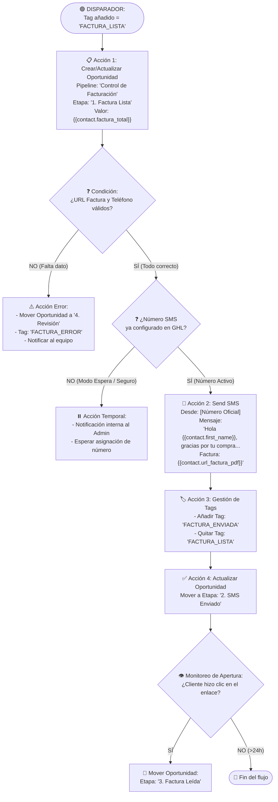

# 📊 Flujograma y Control Visual del Workflow de GHL (LOA Invoice)

Este documento define la arquitectura interna del **Workflow de GHL** para el envío de facturas y el sistema de **Control Visual (Tablero Kanban / Pipeline)** en GoHighLevel.

---

## 1. Sistema de Control Visual en GHL (Tablero de Oportunidades)

Para tener **supervisión visual en tiempo real**, en GHL se utiliza la sección **Opportunities (Oportunidades)** creando un Pipeline llamado **`Control de Facturación`**.

### Columnas del Tablero Visual:
```
┌──────────────────┐    ┌──────────────────┐    ┌──────────────────┐    ┌──────────────────┐
│ 1. FACTURA LISTA │ ➔ │  2. SMS ENVIADO  │ ➔ │ 3. FACTURA LEÍDA │ ➔ │   4. REVISIÓN    │
│                  │    │                  │    │                  │    │ (Sin tel / Error)│
│  [Dina Garcia]   │    │  [Juan Perez]    │    │  [Maria Lopez]   │    │  [Carlos Soto]   │
│  S-97576 ($160)  │    │  S-97570 ($85)   │    │  S-97565 ($120)  │    │  Tel inválido    │
└──────────────────┘    └──────────────────┘    └──────────────────┘    └──────────────────┘
```

Cada vez que el motor genera una factura, la tarjeta del cliente aparece en la columna **Factura Lista** y va avanzando automáticamente.

---

## 2. Flujograma del Workflow Interno de GHL ("LOA Invoice WF")



---

## 3. Número Designado Oficial para Facturas (+1 786-882-8446)

El número oficial asignado y con registro A2P 10DLC aprobado es:
* **Número Remitente:** `+1 786-882-8446` (Miami, Florida)
* **Estado A2P:** Aprobado ✅

### Configuración en GHL:
1. En el bloque **Send SMS** del workflow "LOA Invoice WF":
   * **From Number:** Seleccionar `+1 786-882-8446`.
2. En **Settings ➔ Phone Numbers ➔ +1 786-882-8446**:
   * Desvío de llamadas configurado a mensaje informativo de canal automático.
3. En el Workflow de Auto-Respuesta:
   * Si un cliente responde a este número por SMS, recibe el mensaje no-reply y se archiva la conversación.

---

## 4. Estructura de Tags para Filtros Rápidos (Smart Lists)

En la sección **Contacts ➔ Smart Lists**, puedes crear 3 pestañas guardadas:

| Pestaña Smart List | Filtro por Tag | Utilidad |
|---|---|---|
| **Facturas Listas** | `FACTURA_LISTA` | Facturas generadas por el motor pendientes de envío |
| **Facturas Enviadas** | `FACTURA_ENVIADA` | Clientes que ya recibieron su enlace por SMS |
| **Facturas con Error** | `FACTURA_ERROR` | Clientes con teléfono inválido o sin formato |
